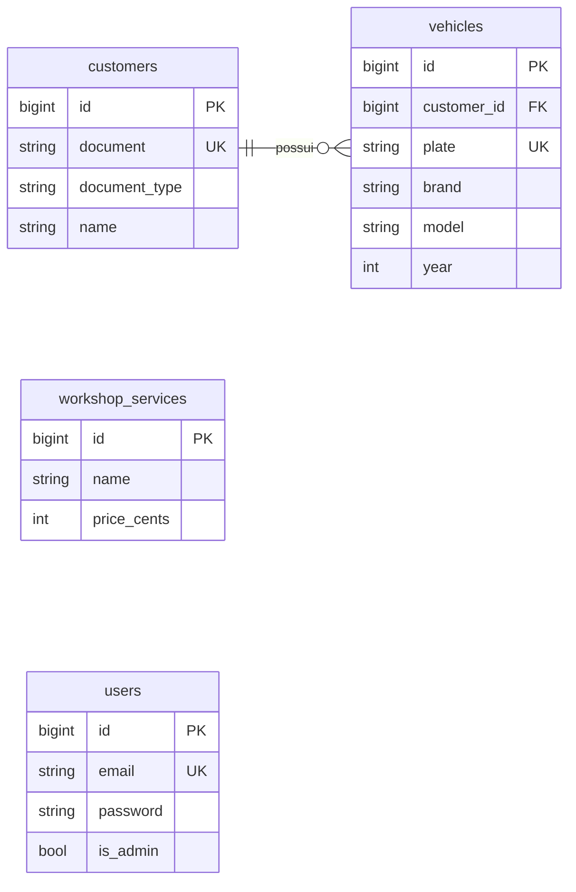
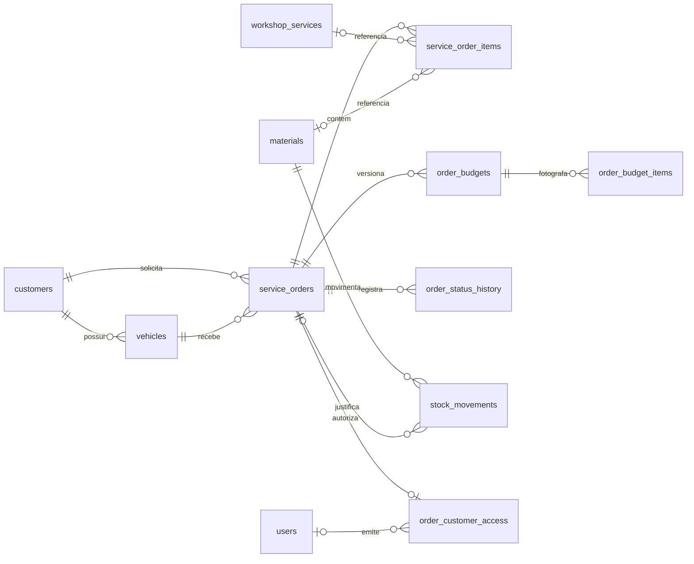
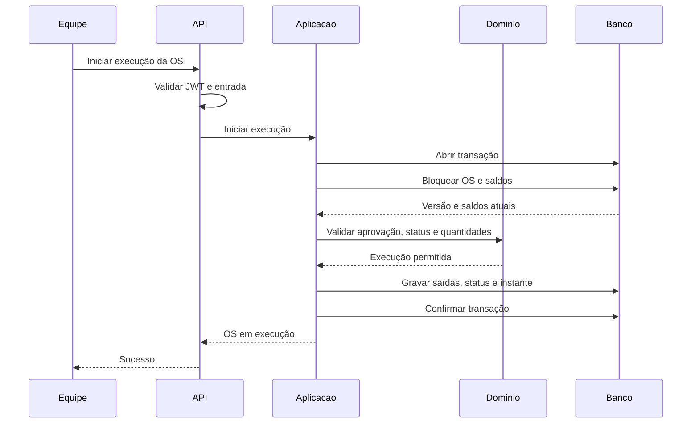
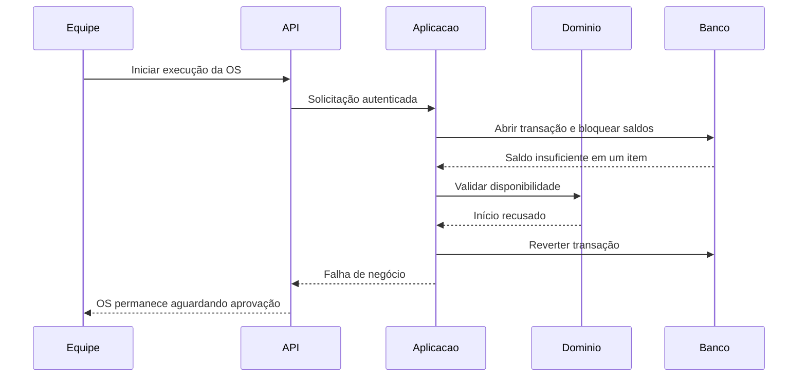

# Diagramas de arquitetura e domínio

Base `4f67f81954b6990a5506e3fece2501720115743a`. [PDF de apoio](diagramas.pdf); [fontes editáveis](fontes/diagramas.json).

## D01 - C4 C1 | Contexto da solução

O contexto de negócio inclui diferentes atores, mas o backend distingue administradores JWT e acesso do cliente restrito à OS. Perfis operacionais separados não foram implementados nem assumidos como requisito. Nenhum aplicativo ou frontend foi incluído na entrega.

| Componente | Conteúdo |
|---|---|
| admin | Administrador; Gerencia cadastros e indicadores |
| equipe | Atendente e mecânico; Recebem, diagnosticam e executam |
| sistema | Sistema da oficina; Backend monolítico; Cadastros existentes; OS e estoque implementados |
| cliente | Cliente; Acompanha OS e decide orçamento; Acesso por API implementado |

Relações: admin → sistema (Administra por API); equipe → sistema (Opera atendimento); cliente → sistema (Consulta e decide).

## D02 - C4 C2 | Contêineres e persistência

Dockerfile e Compose ainda não existem. O diagrama não afirma que MySQL ou um ambiente Docker foram executados nesta revisão. Não há microserviços, broker ou integração de mensageria de negócio implementados.

| Componente | Conteúdo |
|---|---|
| consumidor | Consumidor da API; Postman, Insomnia ou outro cliente HTTP |
| api | Backend Laravel 13 / PHP 8.4.1+; REST, validação, JWT e cadastros; Um único processo de aplicação |
| db | Banco relacional; MySQL: escolha documentada; SQLite: execução de testes validada |

Relações: consumidor → api (HTTP / JSON); api → db (Eloquent / PDO).

## D03 - C4 C3 | Componentes implementados

AppServiceProvider liga contratos às implementações. Aplicação e domínio não importam Eloquent. OS, orçamento, acompanhamento, execução e estoque possuem casos de uso e repositórios. A seta Infraestrutura -> Domínio expressa a dependência de implementação; não uma chamada do domínio ao banco.

| Componente | Conteúdo |
|---|---|
| http | Interface HTTP; Controllers e FormRequests; Cadastros, OS, orçamento e cliente |
| app | Aplicação; Registries e casos de uso; Execução, estoque e indicador |
| domain | Domínio; DocumentNumber, Plate, Money; Quantity e OrderStatus; Contratos de repositório |
| jwt | Segurança; TokenController, AuthenticateAdmin; AdminToken / firebase/php-jwt |
| infra | Infraestrutura; Repositórios Eloquent e Models; Cadastros, OS, estoque e acesso |

Relações: http → app (Invoca casos de cadastro); http → domain (Valida objetos de valor); app → domain (Usa regras e contratos); infra → domain (Implementa contratos); http → jwt (Rotas protegidas por middleware).

## D04 - Mapa de contextos e agregados

As setas mostram dependências de negócio, não comunicação entre serviços distribuídos. OS protege orçamento e itens; Estoque protege saldo. A aplicação coordena os dois agregados na mesma transação. Eventos são fatos conceituais; nenhuma fila é necessária nesta fase. Contextos são limites lógicos; saldo e catálogo compartilham a tabela materials.

| Componente | Conteúdo |
|---|---|
| atendimento | Atendimento; Cliente e Veículo; Cadastros existentes |
| os | Ordens de Serviço; OS raiz; itens e orçamentos internos; Implementado |
| catalogo | Catálogo; Serviço existente; Material implementado; Preço e unidade |
| estoque | Estoque; Saldo de Material; movimentações; Implementado |

Relações: os → atendimento (Referencia cliente e veículo por ID); os → catalogo (Referencia itens e copia valores); estoque → catalogo (Referencia material); os → estoque (Aplicação coordena início e baixa em transação).

## D05 - Estados da Ordem de Serviço

Aprovar ou rejeitar registra a decisão e mantém Aguardando aprovação. A rejeição bloqueia execução. Iniciar revisão retorna ao diagnóstico. Outras transições são recusadas. A passagem para Em execução inclui baixa atômica dos materiais.

```mermaid
stateDiagram-v2
 direction LR
 state "Recebida" as recebida
 state "Em diagnóstico" as diagnostico
 state "Aguardando aprovação" as aguardando
 state "Em execução" as execucao
 state "Finalizada" as finalizada
 state "Entregue" as entregue
 [*] --> recebida: Abrir OS
 recebida --> diagnostico: Iniciar diagnóstico
 diagnostico --> aguardando: Apresentar orçamento
 aguardando --> diagnostico: Revisar proposta
 aguardando --> execucao: Aprovação e saldo
 execucao --> finalizada: Finalizar
 finalizada --> entregue: Entregar
 entregue --> [*]
```

## D06 - DER | Cadastros implementados

users autentica administradores; não há vínculo implementado entre users e customers. workshop_services é catálogo independente. Exclusão de cliente com veículo é restringida por FK. As tabelas do atendimento e estoque aparecem na vista D07.

## D07 - DER | Atendimento, orçamento e estoque implementados

Nomes físicos usados nas migrations. Item referencia serviço OU material. Versões preservam valores. order_customer_access limita a credencial a uma OS. users registra o administrador responsável quando aplicável.

## D08 - Sequência | Início de execução com sucesso

Bloqueios e verificações protegem contra concorrência, decisão obsoleta e repetição de baixa. POST /api/service-orders/{order}/start-execution inicia o fluxo. Serviços sem materiais continuam sujeitos à aprovação, mas não exigem saída de estoque.

## D09 - Sequência | Estoque insuficiente

A aprovação permanece registrada, mas não autoriza saldo negativo. Nenhuma saída nem mudança de status deve persistir. A mesma exigência de atomicidade vale para falha durante a gravação. O contrato HTTP de erro ainda usa HTTP 409 nas violações de negócio.

## Entidades e objetos de valor

Cliente, Veículo, Serviço, Material, OS e Orçamento têm identidade persistida
por modelos Eloquent de infraestrutura. Não há uma classe de entidade pura
para cada modelo. O domínio contém contratos, `DocumentNumber`, `Plate`,
`Money` (centavos), `Quantity` (milésimos), `OrderStatus`, `BudgetDecision` e
`ExecutionTimeSummary`, sem dependência de Eloquent.

OS é a raiz conceitual dos itens, versões, decisão e histórico. Estoque protege
saldo e movimentações; sua persistência compartilha `materials` com o catálogo.
Os repositórios transacionais coordenam os agregados dentro do mesmo banco.
