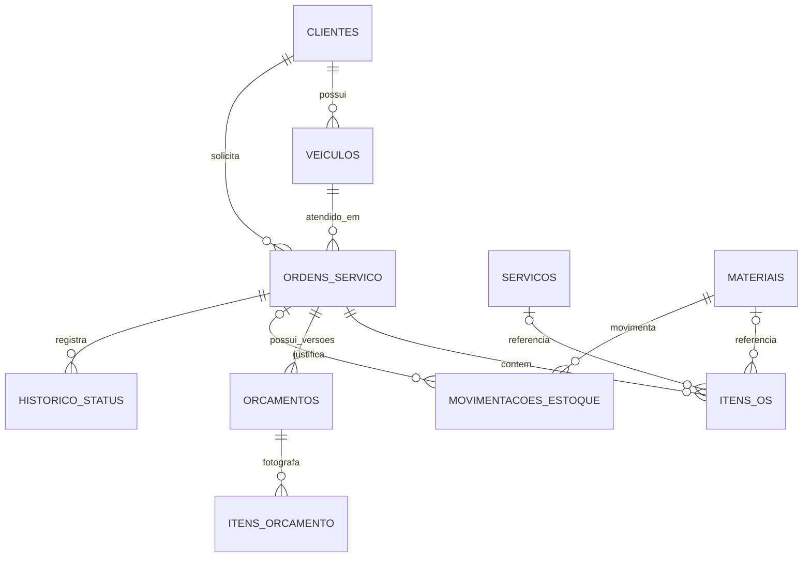

# Modelo de dados da Fase 1

Este é o modelo lógico para orientar as migrations dos próximos PRs. Identificadores internos são chaves técnicas; CPF/CNPJ e placa são as identificações de negócio. Valores monetários são armazenados em centavos inteiros e quantidades de insumos em decimal exato.

Cada item da OS referencia exatamente um serviço ou um material; as duas relações opcionais do diagrama são mutuamente exclusivas. Movimentações de entrada podem existir sem vínculo com uma OS.

## Cadastros

| Tabela | Campos principais | Restrições de domínio |
| --- | --- | --- |
| `clientes` | `id`, `nome`, `tipo_documento`, `documento`, `email`, `telefone`, datas de criação/atualização | CPF/CNPJ normalizado e único; formato e dígitos verificadores válidos. |
| `veiculos` | `id`, `cliente_id`, `placa`, `marca`, `modelo`, `ano`, datas | Placa normalizada e única; marca, modelo e ano obrigatórios; cliente existente. |
| `servicos` | `id`, `nome`, `descricao`, `preco_centavos`, `ativo`, datas | Nome obrigatório; preço não negativo. |
| `materiais` | `id`, `tipo` (`PECA` ou `INSUMO`), `nome`, `unidade`, `preco_centavos`, `estoque_atual`, `ativo`, datas | Tipo e unidade obrigatórios; estoque não negativo; peça usa unidade inteira. A API expõe peças e insumos separadamente, embora compartilhem regras de estoque. |

## Atendimento e orçamento

| Tabela | Campos principais | Restrições de domínio |
| --- | --- | --- |
| `ordens_servico` | `id`, `cliente_id`, `veiculo_id`, `status`, `queixa`, `diagnostico`, `iniciada_em`, `finalizada_em`, `entregue_em`, datas | Cliente deve ser o responsável pelo veículo; status em uma das seis etapas do enunciado. |
| `itens_os` | `id`, `ordem_servico_id`, referência a serviço **ou** material, `quantidade`, `unidade`, `preco_unitario_centavos`, `subtotal_centavos` | Exatamente uma referência; quantidade positiva; preço copiado do catálogo ao incluir o item. |
| `orcamentos` | `id`, `ordem_servico_id`, `versao`, `total_centavos`, `apresentado_em`, `decisao`, `decidido_em`, datas | Versão única por OS; decisão `PENDENTE`, `APROVADO` ou `REJEITADO`; proposta apresentada é imutável. |
| `itens_orcamento` | `id`, `orcamento_id`, `tipo`, `descricao`, `quantidade`, `unidade`, `preco_unitario_centavos`, `subtotal_centavos` | Fotografia dos itens apresentados; soma dos subtotais igual ao total do orçamento. |
| `historico_status` | `id`, `ordem_servico_id`, `status_anterior`, `status_novo`, `ocorrido_em` | Registra cada transição permitida para auditoria e acompanhamento. |

## Estoque e acesso

| Tabela | Campos principais | Restrições de domínio |
| --- | --- | --- |
| `movimentacoes_estoque` | `id`, `material_id`, `ordem_servico_id` opcional, `tipo` (`ENTRADA` ou `SAIDA`), `quantidade`, `motivo`, `ocorrido_em` | Quantidade positiva; saída não pode levar o saldo abaixo de zero; baixa de OS ocorre uma vez, dentro da transação de início da execução. |
| `users` | Estrutura de usuários do Laravel, com papel administrativo a definir na implementação da autenticação | JWT protegerá as APIs administrativas. O mecanismo de acesso do cliente à própria OS será definido na etapa de acompanhamento. |

## Integridade e cálculos

- Chaves estrangeiras impedem referências a clientes, veículos, serviços e materiais inexistentes. Exclusão de cadastros já usados em OS não pode apagar histórico; a política de inativação será aplicada na implementação.
- O sistema valida transições de status e propriedade do veículo antes de persistir. Restrições de unicidade do banco protegem documento, placa e versão do orçamento contra concorrência.
- A geração do orçamento grava uma versão com os valores então vigentes. Mudanças futuras no catálogo não recalculam propostas históricas.
- O total soma os subtotais de `itens_orcamento`, arredondados individualmente para centavos conforme as regras da OS; o tempo médio usa `iniciada_em` e `finalizada_em` de OS finalizadas ou entregues.
- A baixa de estoque usa transação e bloqueio dos saldos envolvidos para impedir que atendimentos concorrentes consumam o mesmo material.

Este modelo ainda é uma decisão de projeto, não uma alegação de que as migrations e regras já estejam implementadas.
